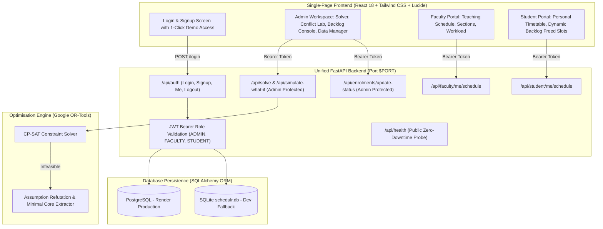

# Schedulr — University Timetable Clash Resolver

> **"Build timetables. Resolve conflicts. Save weeks of manual work."**

Schedulr is a production-grade university timetable optimization and clash-resolution web application. It ingests course sections, student enrollments (including complex cross-department electives and backlog students), faculty availability preferences, and room capacities to either generate a mathematically optimal clash-free schedule or **diagnose the exact minimal blocking constraint core** when a feasible timetable is impossible.

Now upgraded with a complete backend-connected **Authentication, Signup, Role-Based Access Control (RBAC), and Logout** system powered by FastAPI, SQLAlchemy, Bcrypt password hashing, and signed JWT Bearer access tokens.

---

## 🌟 Key Features

1. **Role-Based Access Control (RBAC) & Secure Authentication**:
   - **Backend-Connected Auth**: Fast, production-grade authentication with SQLAlchemy, Passlib (Bcrypt), and Python-Jose JWT access tokens.
   - **Three Distinct Roles**:
     - `ADMIN`: Academic Administrators & Timetable Coordinators. Full access to OR-Tools solver, Conflict Lab, What-If simulator, Dynamic Backlog management console, data manager, and imports/exports.
     - `FACULTY`: Tailored Faculty Portal (e.g. Dr. Alan Turing). View assigned sections, weekly teaching timetable, contact hours, active teaching days, and availability constraints.
     - `STUDENT`: Tailored Student Portal (e.g. Alex Vance, 2026CS104). View personal weekly schedule, registered courses, active backlogs, and automatically freed study periods.
   - **Session Security**: Pure `sessionStorage` token isolation with `Authorization: Bearer <token>` API header injection and auto-logout on token expiration.
   - **Public Student Registration**: Public `/api/auth/signup` validates full name, registration number, email, and password (min 8 chars), strictly assigning the `STUDENT` role (preventing unauthorized privilege escalation).

2. **Dynamic Backlog Resolution (Zero-Churn Slot Freeing)**:
   - When a student clears a backlog examination after the timetable has been published, they are immediately un-enrolled from that backlog section.
   - **Student Personal Timetable**: The scheduled course slot is automatically freed with a distinctive highlighted badge: **`✨ Free after backlog cleared`** (*"Backlog successfully cleared! This slot is now your dedicated personal study time"*).
   - **Master Timetable Stability**: The global schedule for faculty, rooms, and other enrolled students remains 100% stable without triggering campus-wide disruptions or unnecessary re-solving.
   - **Conflict Lab Integration**: Clashes caused purely by that student's backlog (e.g. Alex Vance's Monday 10:00 AM overlap between EE204 and CS201) are permanently eliminated.
   - **Audit Trail & Undo**: Full history of backlog status updates with administrator notes and reversible states (`Active`, `Cleared`, `Dropped`, `Pending`).

3. **Google OR-Tools CP-SAT Optimisation Engine**:
   - Zero double-bookings guaranteed mathematically across students, faculty, and physical classrooms.
   - Discrete 40-slot weekly schedule (Monday–Friday, 09:00–17:00).
   - Solves 120 sections and 1,500 students in ~31 seconds (well under the 60s benchmark limit).

4. **Conflict Lab & Explainable Infeasibility**:
   - When conflicting constraints make a valid timetable impossible, Schedulr isolates the exact conflict core using CP-SAT assumption refutation and structural graph bottleneck diagnostics.
   - Explains the conflict in plain English (e.g., *"CS301 and EE204 cannot be scheduled without a clash because 42 students are enrolled in both sections, both require the only 80-seat laboratory, and their assigned faculty are unavailable outside Tuesday 10:00–11:00"*).
   - Interactive **"What-If?" Simulator** enables testing policy remedies (expand faculty hours, provision auxiliary labs, split sections) with 1 click and verify instant feasibility.

5. **Soft-Constraint Multi-Objective Optimization**:
   - **Lunch Protection**: Heavily penalizes scheduling lectures during the 13:00–14:00 university dining hour.
   - **Student Fatigue Minimization**: Penalizes >3 back-to-back continuous hours for any student cohort.
   - **Classroom Utilization Efficiency**: Avoids putting small 30-student classes into 200-seat auditoriums.
   - **Faculty Balance**: Prevents overloaded days and fragmented teaching schedules.

6. **High-Contrast Black, Yellow & White Visual Identity**:
   - Cyber-academic dark mode: obsidian black background (`#09090b`), electric golden yellow highlights (`#facc15`), and crisp pure white typography.
   - Multi-view timetable grids: Master, By Room, By Faculty, and By Student views with one-click CSV export and print-optimized PDF layout (`@media print`).

---

## 👥 Demo Accounts & 1-Click Access

Schedulr includes 3 pre-seeded synthetic demo accounts accessible with **1-click quick-fill buttons** directly on the login screen:

| Role | Name / Identifier | Email | Password | Capabilities |
| :--- | :--- | :--- | :--- | :--- |
| **`ADMIN`** | Academic Administrator | `admin@schedulr.demo` | `Schedulr2026!` | Full Solver, Conflict Lab, What-If Simulator, Backlog Console, Data Manager |
| **`FACULTY`** | Dr. Alan Turing (`FAC-CS1`) | `faculty@schedulr.demo` | `Faculty2026!` | Personal Teaching Timetable, Assigned Sections, Weekly Load, Availability |
| **`STUDENT`** | Alex Vance (`2026CS104`) | `student@schedulr.demo` | `Student2026!` | Personal Timetable, Enrolled Courses, Dynamic Backlog Tracker, Freed Slots |

---

## 🏛️ System Architecture



---

## 🚀 Quickstart & Local Installation

### Prerequisites
- Python 3.10+ (Tested and verified on Python 3.14)
- Modern web browser (Chrome, Edge, Firefox, Safari)

### 1. Installation
Clone the repository:
```bash
git clone https://github.com/punarbh/schedulr.git
cd schedulr
```

Install the dependencies:
```bash
pip install -r requirements.txt
```

### 2. Run the Application
Launch with the single-command runner:
```bash
python run.py
```

The application will start immediately:
- **Web UI**: Open your browser at [http://127.0.0.1:8000](http://127.0.0.1:8000)
- **Interactive Swagger API Docs**: [http://127.0.0.1:8000/docs](http://127.0.0.1:8000/docs)
- **Health Check**: [http://127.0.0.1:8000/api/health](http://127.0.0.1:8000/api/health)

*(Note: The FastAPI backend serves the frontend single-page application directly from the same service. No separate frontend build or Node.js server is needed).*

---

## ⚙️ Environment Variables & Render Deployment

Schedulr is configured for **zero-configuration single-service deployment** on Render via `render.yaml`:

```yaml
services:
  - type: web
    name: schedulr
    runtime: python
    buildCommand: pip install -r requirements.txt
    startCommand: uvicorn backend.main:app --host 0.0.0.0 --port $PORT
    healthCheckPath: /api/health
```

### Environment Variables

| Variable | Required | Default | Description |
| :--- | :---: | :--- | :--- |
| `DATABASE_URL` | Optional | `sqlite:///schedulr.db` | PostgreSQL database connection URL. Automatically converts legacy `postgres://` to `postgresql://`. If not set, falls back to local SQLite. |
| `JWT_SECRET` | Recommended | Auto-generated dev secret | Secret key used to sign HMAC-SHA256 JWT tokens. Set a strong secret in production. |
| `ACCESS_TOKEN_EXPIRE_MINUTES` | Optional | `480` (8 hours) | Expiration time for access tokens in minutes. |
| `PORT` | Optional | `8000` | Port for Uvicorn HTTP server (automatically supplied by Render). |

---

## 🧪 Automated Testing

Schedulr includes an exhaustive automated test suite covering all constraint logic, Dynamic Backlog Resolution, password hashing, and role-based access control.

Execute all tests:
```bash
python -m unittest discover tests
```

### Test Suite Breakdown:

#### 1. Authentication & RBAC Suite (`tests/test_auth_rbac.py` - 10 Tests)
- `test_01_password_hashing`: Verifies bcrypt hashing, salt verification, and rejection of plain text.
- `test_02_valid_login_returns_jwt`: Validates login for Admin, Faculty, and Student, returning valid JWT tokens with safe user profiles (passwords never leaked).
- `test_03_invalid_password_returns_401`: Verifies HTTP 401 Unauthorized with `WWW-Authenticate: Bearer` on invalid credentials.
- `test_04_duplicate_signup_returns_400`: Verifies rejection of duplicate email registrations.
- `test_05_public_signup_only_creates_student`: Enforces that public signups can only create `STUDENT` accounts even if escalated parameters are passed.
- `test_06_student_cannot_access_solve_or_update_status`: Proves student tokens receive HTTP 403 Forbidden on administrative endpoints.
- `test_07_faculty_cannot_access_solve`: Proves faculty tokens receive HTTP 403 Forbidden on timetable solve requests.
- `test_08_faculty_schedule_endpoint`: Verifies `/api/faculty/me/schedule` returns assigned teaching sections and workload insights.
- `test_09_student_schedule_endpoint`: Verifies `/api/student/me/schedule` returns personal timetable with labeled `"Free after backlog cleared"` slots.
- `test_10_existing_backlog_clearance_and_solver`: Verifies administrative solver and dynamic backlog clearance operate seamlessly under RBAC.

#### 2. Dynamic Backlog Resolution Suite (`tests/test_backlog_resolution.py` - 4 Tests)
- `test_1_active_backlog_creates_clash`: Verifies active backlog enforces pairwise student non-overlap constraint.
- `test_2_cleared_backlog_removes_clash`: Verifies cleared backlog is excluded from constraints and resolves conflict.
- `test_3_cleared_enrolment_does_not_inflate_room_capacity`: Verifies room matching uses active enrolment count.
- `test_4_reactivating_backlog_restores_clash`: Verifies restoring a backlog restores clash detection (undo capability).

---

## 📊 Pre-Loaded Benchmark Scenarios

| Scenario | Sections | Students | Faculty | Rooms | Runtime | Status | Key Feature |
| :--- | :---: | :---: | :---: | :---: | :---: | :---: | :--- |
| **Feasible Demo** | 16 | 180 | 16 | 10 | **0.88s** | `OPTIMAL` | 100% lunch compliance, zero student clashes, room fit |
| **Backlog Clearance Demo** | 5 | 82 | 5 | 5 | **0.04s** | `FEASIBLE_WITH_CLASH` | Alex Vance (2026CS104) backlog clearance, instant slot release, master stability |
| **Impossible Clash Demo** | 4 | 103 | 4 | 5 | **0.00s** | `INFEASIBLE` | 42 shared students, 1 lab, narrow Tue 10-11 AM slot |
| **Large Benchmark** | 120 | 1,500 | 60 | 35 | **31.37s** | `OPTIMAL` | 8 departments, high-volume CP-SAT solve (< 60s) |

---

## 🤖 AI Usage Declaration

In accordance with hackathon viva guidelines, this application was developed with AI assistance from Google Antigravity:
- **OR-Tools Constraint Formulation**: Co-developed high-performance CP-SAT Boolean clause formulation with `AddAtMostOne` clique reductions.
- **Minimal Conflict Core Extraction**: Formulated deletion-based bottleneck detection and assumption refutation logic.
- **Authentication & RBAC Architecture**: Implemented robust SQLAlchemy database layer, bcrypt hashing, JWT token authorization, and role protection.
- **Frontend Architecture**: Designed responsive academic-tech dashboard layout with Tailwind CSS, Lucide Icons, and Chart.js in a high-contrast Obsidian Black & Golden Yellow theme.
- **All code, mathematical constraints, and security layers were thoroughly inspected, validated, and benchmarked locally.**
