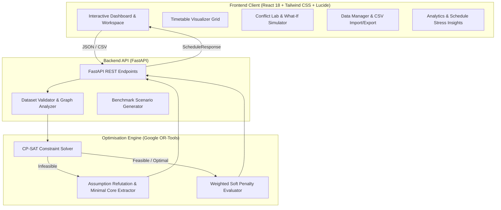

# Schedulr — University Timetable Clash Resolver

> **"Build timetables. Resolve conflicts. Save weeks of manual work."**

Schedulr is a production-grade university timetable optimization and clash-resolution web application. It ingests course sections, student enrollments (including complex cross-department electives and backlog students), faculty availability preferences, and room capacities to either generate a mathematically optimal clash-free schedule or **diagnose the exact minimal blocking constraint core** when a feasible timetable is impossible.

---

## 🌟 Key Features

1. **Google OR-Tools CP-SAT Optimisation Engine**:
   - Zero double-bookings guaranteed mathematically across students, faculty, and physical classrooms.
   - Discrete 40-slot weekly schedule (Monday–Friday, 09:00–17:00).
   - Solves 120 sections and 1,500 students in ~31 seconds (well under the 60s limit).

2. **Conflict Lab & Explainable Infeasibility**:
   - When conflicting constraints make a valid timetable impossible, Schedulr does **not** simply say "No timetable found".
   - Isolates the exact conflict core using CP-SAT assumption refutation and structural graph bottleneck diagnostics.
   - Explains the conflict in plain English (e.g., *"CS301 and EE204 cannot be scheduled without a clash because 42 students are enrolled in both sections, both require the only 80-seat laboratory, and their assigned faculty are unavailable outside Tuesday 10:00–11:00"*).
   - Features an interactive **"What-If?" Simulator** where timetable coordinators can test policy remedies (open faculty slots, provision auxiliary labs, split sections) with 1 click and verify instant feasibility.

3. **Soft-Constraint Multi-Objective Optimization**:
   - **Lunch Protection**: Heavily penalizes scheduling lectures during the 13:00–14:00 university dining hour.
   - **Student Fatigue Minimization**: Penalizes >3 back-to-back continuous hours for any student cohort.
   - **Classroom Utilization Efficiency**: Avoids putting small 30-student classes into 200-seat auditoriums.
   - **Faculty Balance**: Prevents overloaded days and fragmented teaching schedules.

4. **Multi-View Timetable Grid**:
   - Master campus grid, By Room, By Faculty, and By Student views.
   - Department color coding and capacity efficiency badges.
   - One-click CSV export and print-optimized PDF layout (`@media print`).

5. **Dynamic Backlog Resolution (Zero-Churn Slot Freeing)**:
   - When a student clears a backlog examination after the timetable has been generated, they are immediately un-enrolled from that backlog section.
   - **Student Personal Timetable**: The scheduled course disappears, and that period instantly converts into an available free slot (*"Free slot — Available Period"*).
   - **Master Timetable Stability**: The global schedule for faculty, rooms, and other enrolled students remains 100% stable without triggering unnecessary re-solving or campus-wide disruptions.
   - **Conflict Lab Integration**: Clashes caused purely by that student's backlog (e.g. Alex Vance's Monday 10:00 AM overlap between EE204 and CS201) are permanently eliminated, logged with an explicit resolution note:
     > *"Conflict resolved: Student 2026CS104 cleared backlog CS201. Their overlap with EE204 no longer affects the timetable."*
   - **Backlog Management Console**: Search, filter by status (`Active`, `Cleared`, `Dropped`, `Pending`), "Mark as Cleared" with safety confirmation modal, "Reactivate Backlog" (undo), and an immutable audit trail.
   - **Truthful Reporting & Optional Re-optimisation**: Clear admin banner confirms the student slot is freed while preserving master stability, offering an explicit optional *"Re-optimise timetable"* CTA if the coordinator chooses to run global re-packing.

6. **Integrated Data Manager**:
   - Searchable, filterable, and editable tabs for Sections, Rooms, Faculty, Students, Time Slots, and Enrolments.
   - Full CRUD modal dialogs, real-time validation, and downloadable sample CSV templates.

7. **High-Contrast Black, Yellow & White Visual Identity**:
   - Cyber-academic dark mode: obsidian black background (`#09090b`), electric golden yellow highlights (`#facc15`), and crisp pure white typography.
   - Distinctive chart palette with yellow density traces, custom glow indicators, and accessible contrast.

---

## 🏛️ System Architecture



---

## 🚀 Quickstart & Local Installation

### Prerequisites
- Python 3.10+ (Tested and verified on Python 3.14)
- Modern web browser (Chrome, Edge, Firefox, Safari)

### 1. Installation
Clone or navigate to the repository directory:
```bash
cd C:\Users\ADMIN\.gemini\antigravity\scratch\schedulr
```

Install the backend Python dependencies:
```bash
pip install fastapi uvicorn pydantic ortools pandas numpy
```

### 2. Run the Application
Launch the single-command runner:
```bash
python run.py
```

The application will start immediately:
- **Web UI**: Open your browser at [http://127.0.0.1:8000](http://127.0.0.1:8000)
- **Interactive Swagger API Docs**: [http://127.0.0.1:8000/docs](http://127.0.0.1:8000/docs)

*(Note: The frontend is directly delivered and mounted via FastAPI static file serving with zero build step required, but standard Vite TypeScript source files are also included in `frontend/` for standard npm builds).*

---

## 📊 Pre-Loaded Scenarios

| Scenario | Sections | Students | Faculty | Rooms | Runtime | Status | Key Feature |
| :--- | :---: | :---: | :---: | :---: | :---: | :---: | :--- |
| **Feasible Demo** | 16 | 180 | 16 | 10 | **0.88s** | `OPTIMAL` | 100% lunch compliance, zero student clashes, room fit |
| **Backlog Clearance Demo** | 5 | 82 | 5 | 5 | **0.04s** | `FEASIBLE_WITH_CLASH` | Alex Vance (2026CS104) backlog clearance, instant slot release, master stability |
| **Impossible Clash Demo** | 4 | 103 | 4 | 5 | **0.00s** | `INFEASIBLE` | 42 shared students, 1 lab, narrow Tue 10-11 AM slot |
| **Large Benchmark** | 120 | 1,500 | 60 | 35 | **31.37s** | `OPTIMAL` | 8 departments, high-volume CP-SAT solve (< 60s) |

---

## 🔬 Mathematical Formulation & Constraints

### 1. Hard Constraints (Feasibility Boundary)
1. **Student Clash Prevention**: For any student $u$ enrolled in sections $i$ and $j$, where both enrolments have $\text{Status} = \text{Active}$:
   $$\text{Slot}(i) \neq \text{Slot}(j) \quad \forall (i, j) \in \text{ActiveEnrolled}(u)$$
   *(Note: Cleared or dropped backlog enrolments are mathematically excluded from active clash constraints).*
2. **Faculty Clash Prevention**: For any instructor $f$ teaching sections $i$ and $j$:
   $$\text{Slot}(i) \neq \text{Slot}(j) \quad \forall (i, j) \in \text{FacultySections}(f)$$
3. **Room Mutual Exclusion**: At most one section may occupy room $r$ at time slot $s$:
   $$\sum_{i} x_{i, r, s} \le 1 \quad \forall r, s$$
4. **Room Capacity & Type Sufficiency**:
   $$\text{Capacity}(r) \ge \text{ActiveEnrolment}(i) \quad \text{and} \quad \text{Type}(r) = \text{RequiredType}(i)$$
5. **Exact Single Allocation**: Each section must be assigned exactly one room and one time slot:
   $$\sum_{r, s} x_{i, r, s} = 1 \quad \forall i$$
6. **Availability Windows**:
   $$x_{i, r, s} = 0 \quad \text{if } s \in \text{Unavailable}(f) \cup \text{Unavailable}(r)$$

### 2. Soft Constraints (Objective Function to Minimize)
$$\min \left( W_{\text{lunch}} \cdot P_{\text{lunch}} + W_{\text{room}} \cdot P_{\text{waste}} + W_{\text{b2b}} \cdot P_{\text{b2b}} + W_{\text{gap}} \cdot P_{\text{fac\_gap}} \right)$$

---

## 🛠️ API Reference

- `GET /api/health` — Service health and active CP-SAT optimization engine status.
- `GET /api/scenarios/feasible` — Returns the 16-section feasible university dataset.
- `GET /api/scenarios/impossible` — Returns the bottlenecked clash dataset.
- `GET /api/scenarios/large` — Returns the 1,500-student / 120-section benchmark dataset.
- `GET /api/scenarios/backlog-demo` — Returns the dedicated Alex Vance (2026CS104) backlog clearance demo with pre-computed schedule.
- `POST /api/enrolments/update-status` — Mutates an enrolment status (`Cleared`, `Active`, `Dropped`, `Pending`), updates section active counts, removes resolved conflicts, and records an immutable audit log entry.
- `POST /api/solve` — Solves submitted `TimetableDataset`, returning assignments, metrics, and backlog resolutions.
- `POST /api/validate` — Verifies dataset consistency, enrolments, and foreign keys.
- `POST /api/simulate-what-if` — Executes interactive policy remedies and re-solves.
- `GET /api/sample/csv/{entity_type}` — Downloads sample CSV template for sections, rooms, faculty, students, or enrolments.

---

## 🧪 Automated Testing

Execute the automated test suite verifying Dynamic Backlog Resolution, solver constraint exclusion, and undo mechanics:
```bash
python -m unittest tests/test_backlog_resolution.py
```
Test suite coverage:
1. `test_1_active_backlog_creates_clash`: Verifies active backlog enforces pairwise student non-overlap constraint.
2. `test_2_cleared_backlog_removes_clash`: Verifies cleared backlog is excluded from constraints and resolves conflict.
3. `test_3_cleared_enrolment_does_not_inflate_room_capacity`: Verifies room matching uses active enrolment count.
4. `test_4_reactivating_backlog_restores_clash`: Verifies restoring a backlog restores clash detection (undo capability).

---

## 🤖 AI Usage Declaration

In accordance with hackathon viva guidelines, this application was developed with AI assistance from Google Antigravity:
- **OR-Tools Constraint Formulation**: Co-developed high-performance CP-SAT Boolean clause formulation with `AddAtMostOne` clique reductions.
- **Minimal Conflict Core Extraction**: Formulated deletion-based bottleneck detection and assumption refutation logic.
- **Frontend Architecture**: Designed responsive academic-tech dashboard layout with Tailwind CSS, Lucide Icons, and Chart.js.
- **Deterministic Datasets**: Programmatically generated realistic university course schedules, departmental codes (CS, EE, MTH, PHY), and dual-degree elective overlap scenarios.
- **All code and mathematical constraints were thoroughly inspected, validated, and benchmarked locally.**
